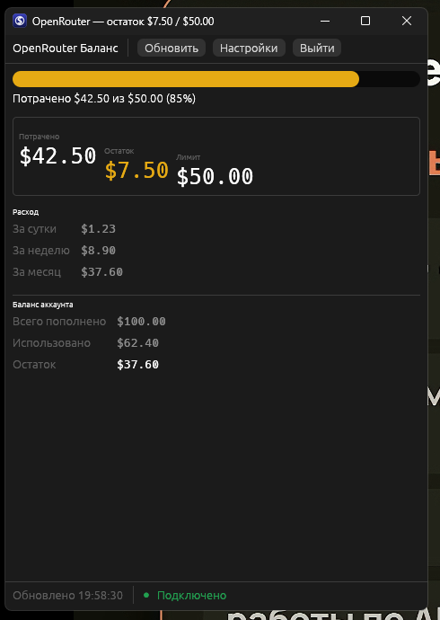
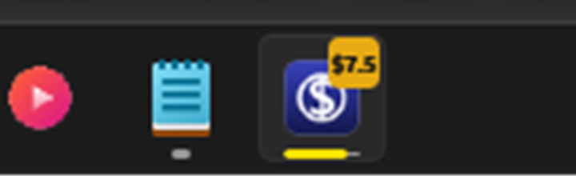

# OpenRouter Баланс

Небольшое приложение для Windows 10/11 на Rust: показывает расход и остаток лимита вашего ключа OpenRouter
(и, при наличии management-ключа, общий баланс аккаунта) **прямо на панели задач** — без открытия окна.



## Что видно на панели задач

Windows 11 не позволяет добавить собственный виджет в панель задач (deskband удалены), поэтому используются три штатных механизма одновременно:

| Механизм | Что показывает |
|---|---|
| **Иконка в трее** | Динамическая иконка с остатком (`$12`, `$9.5`, `$.85`), фон по порогам: зелёный → жёлтый (остаток < 20 %) → красный (< 5 %); синий — у ключа нет лимита (тогда на иконке *потрачено*); серый `!` — ошибка обновления (никакого ложного «0»). Тултип: потрачено, остаток/лимит, баланс аккаунта, время обновления. ЛКМ — показать/скрыть окно, ПКМ — меню: «Обновить», «Настройки», «Автозапуск», «Выход». |
| **Кнопка на панели задач** | Полоса прогресса = доля потраченного лимита (зелёная / жёлтая / красная — по тем же порогам; при ошибке — красная), оверлей-значок с остатком или `!`. Без лимита полоса скрыта. |
| **Заголовок окна / миниатюра** | `OpenRouter — остаток $12.40 / $50.00` (без лимита: `потрачено $12.40`; при ошибке: `ошибка, устарело: …`). |



> В Windows 11 новые значки трея по умолчанию попадают в «скрытые» (стрелка `^`). Перетащите значок на панель, либо включите его в
> *Параметры → Персонализация → Панель задач → Другие значки области уведомлений*.

Закрытие окна (X) сворачивает приложение в трей — оно продолжает обновляться. Повторный запуск не создаёт второй экземпляр, а показывает уже открытое окно.

## Сборка и запуск

Нужны: Rust stable (edition 2021), MSVC Build Tools + Windows SDK (для `rc.exe`, встраивает иконку и манифест).

```powershell
cargo run --release
# или
cargo build --release   # target\release\openrouter-balance.exe — один файл, без рантаймов
cargo test
cargo clippy --all-targets -- -D warnings
```

> **Если путь к проекту содержит кириллицу или пробелы**, `ring` (зависимость rustls) может упасть с `cl.exe: error D8050`.
> Обход: `$env:CARGO_TARGET_DIR = "C:\orb-target"` перед `cargo build`.

Первый запуск: нажмите «Войти через OpenRouter» (откроется браузер) либо введите обычный API-ключ вручную.

Параметры командной строки: `--minimized` (запуск свёрнутым в трей; его использует автозапуск).

## Обычный ключ и management-ключ

| | Обычный ключ (OAuth или созданный вручную) | Management-ключ |
|---|---|---|
| Что даёт | `GET /api/v1/key`: usage, limit, limit_remaining, usage_daily/weekly/monthly, budgets, effective_budget | Дополнительно `GET /api/v1/credits`: `total_credits`, `total_usage` — общий баланс аккаунта |
| Как получить | Вход через OAuth в приложении или на странице ключей | Только вручную на openrouter.ai (раздел Management API Keys) |
| Риск | Ограничен инференсом | **Широкие права: создание и удаление API-ключей аккаунта** |

* Вход через OAuth PKCE выдаёт **только обычный ключ**. Получить management-ключ через OAuth нельзя (по документации OpenRouter management-ключи создаются вручную) — приложение этого не обещает.
* Без management-ключа блок «Баланс аккаунта» скрыт, а `/credits` отвечает 403 — это не ошибка, показывается подсказка «Для общего баланса нужен management-ключ».
* Management-ключ необязателен; вводится в «Настройках», хранится только в Диспетчере учётных данных Windows и никогда не пишется в файлы и логи.

## Безопасность

* Ключи — только в Windows Credential Manager (службы `OpenRouterBalance`, записи `api-key`, `management-key`). Кнопка «Выйти» удаляет оба.
* Настройки (`%APPDATA%\OpenRouterBalance\config.json`) не содержат секретов. При панике пишется только место паники (`panic.log` рядом).
* OAuth: PKCE S256, локальный сервер только на `127.0.0.1`, случайный порт, параметр `state`, закрывается сразу после получения кода, ожидание не дольше 5 минут.

## Устройство

`main.rs` — запуск, окно eframe; `api.rs` — запросы и модели (`/key`, `/credits`, backoff при 429, таймаут 10 с); `auth.rs` — OAuth PKCE и keyring;
`config.rs` — настройки; `format.rs` — деньги, пороги цветов, модель для трея/кнопки/заголовка; `state.rs` — общее состояние;
`worker.rs` — фоновое обновление, вход/выход, уведомления; `taskbar.rs` — трей, `ITaskbarList3`, автозапуск, единственный экземпляр; `ui.rs` — интерфейс.
Win32-слой работает в отдельном потоке со своим циклом сообщений, поэтому трей и панель задач обновляются, даже когда окно скрыто.

## Добавлено сверх ТЗ

* Флаг `--demo[=green|yellow|red|nolimit|error]` — фиктивные данные без сети и ключей, чтобы проверить вид трея и панели задач.
* Синий цвет для ключа без лимита и серый для ошибки/«нет входа» (в ТЗ только зелёный/жёлтый/красный).
* `panic.log` с местом паники (без текста сообщения).

## Известные ограничения

* Встроить виджет в саму панель задач Windows 11 нельзя; используются трей, прогресс/оверлей кнопки и заголовок окна.
* Кнопка панели задач существует, только пока окно не скрыто в трей; при свёрнутом в трей окне данные видны в иконке трея.
* Если OpenRouter не вернёт `state` в OAuth-callback, он принимается без проверки (код защищён PKCE).
* Уведомление Windows показывается через PowerShell AppUserModelID (приложение без установщика).
